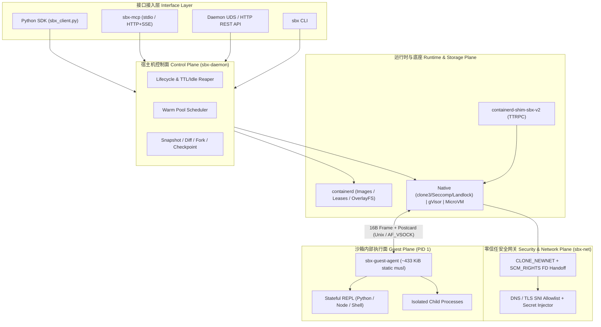
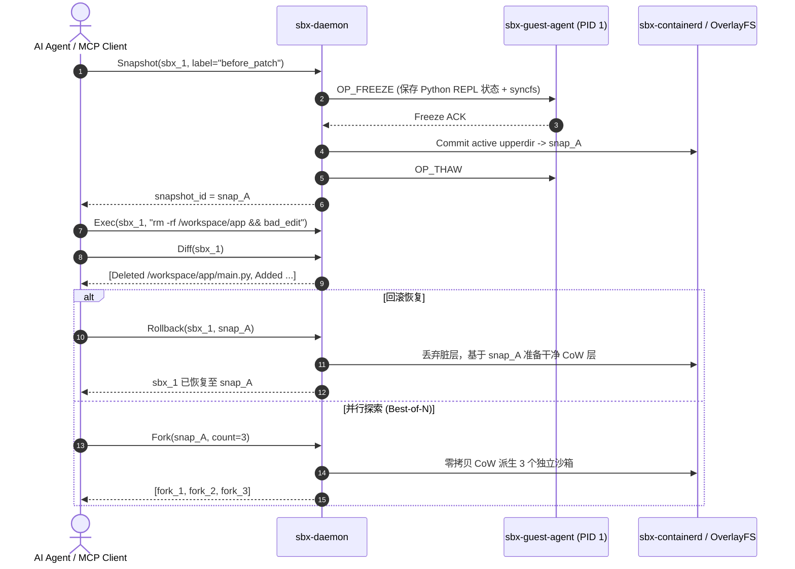
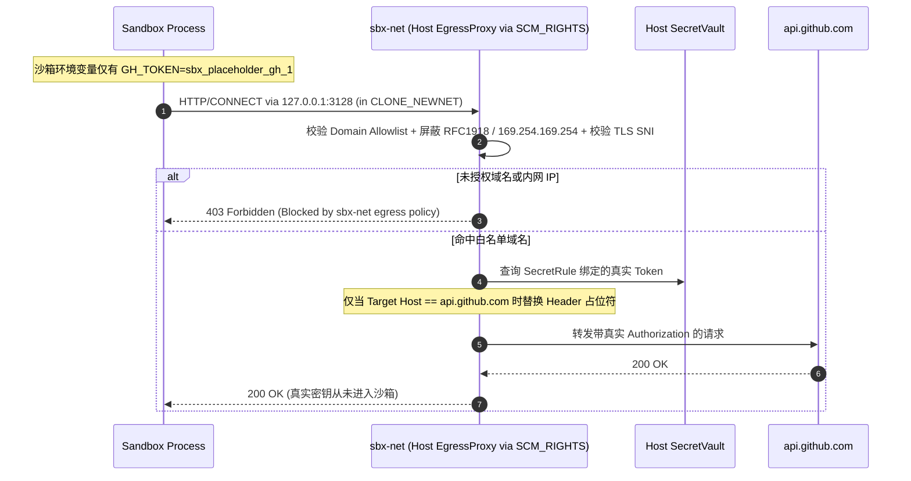

<div align="center">

# 🛡️ Aegis (`aegis`)

**Zero-Trust, Sub-Millisecond AI Sandbox & Code Execution Infrastructure**

**基于 `containerd` 云原生底座、融合 `libracoder/kiri` 极简运行时理念的高性能、强受控 Rust AI 沙箱基础设施**

[](https://github.com/z23ng/aegis/actions/workflows/ci.yml)
[](https://www.rust-lang.org/)
[](./LICENSE)
[](./crates/sbx-guest-agent)
[](./crates/sbx-shim)
[](./crates/sbx-mcp)
[](./SECURITY.md)

[设计哲学](#-设计哲学与核心不变量) •
[系统架构](#-系统架构) •
[纵深安全矩阵](#-纵深安全与隔离后端矩阵) •
[安装向导](#-安装向导) •
[使用说明手册](#-使用说明手册) •
[AI Agent / MCP 集成](#-ai-agent-与-sdk-集成) •
[基准与测试](#-性能基准与测试验证)

</div>

---

## 💡 为什么选择 Aegis？

现代 AI Coding Agent、Code Interpreter 与自动化科研工作流需要**高频、短命、强隔离、可时间旅行回滚且不泄露 API 凭证**的算力沙箱。传统容器栈（`dockerd -> containerd -> containerd-shim -> runc`）或重量级虚拟机均存在结构性瓶颈：

| 评估维度 | 传统 Docker / `runc` | 通用重量级虚拟机 | **Aegis (`sbx`)** |
| :--- | :--- | :--- | :--- |
| **热路径命令派生** | 每次 `exec` 拉起 Go Shim + `runc` 进程（数十毫秒级） | 依赖 SSH / 串口长连接代理 | **亚毫秒级**：常驻 PID 1 Guest Agent 经 `postcard` 二进制帧 + `clone3` 直接派生（实测热路径均值 **0.48 ms**） |
| **有状态代码执行** | 无原生 REPL 上下文，每次执行重复 `import` | 需在 Guest 内额外封装服务 | 原生内置 **Stateful REPL Worker**（Python / Node / Shell），跨调用保留内存变量与已导入模块 |
| **Agent 试错与回滚** | 破坏环境后只能销毁重建 | 全盘镜像快照体积大、复制慢 | 原生 **Step-level Snapshot / Diff / Rollback / CoW Fork**，支持多分支并行探索 |
| **API 凭证隔离** | 明文注入 `env`，Prompt Injection 可直接读取外泄 | 同样面临沙箱内存明文凭证风险 | **Zero-Trust Secret Injector**：沙箱仅持有占位符，真实密钥驻留宿主机内存，域名白名单放行后动态替换 |
| **隔离粒度弹性** | 单一 Linux 容器隔离 | 单一虚拟化边界 | 统一控制面无缝切换 **`Native`（Namespaces + Seccomp + Landlock） / `gVisor` / `MicroVM`** |
| **云原生与 AI 生态** | 仅兼容 OCI / CRI | 镜像与分发体系封闭 | 复用 **`containerd` 镜像与 OverlayFS Snapshotter**，同时原生提供 **`containerd-shim-sbx-v2`**、**MCP Server** 与 **Python SDK** |

---

## 🧭 设计哲学与核心不变量

参考一线基础设施工程实践，**Aegis** 将“**控制面资源管理（`containerd`）**”与“**极简执行面运行时（Kiri 风格 PID 1 + 安全网关）**”彻底解耦，并强制约束以下四条架构不变量（详见 [AGENTS.md](./AGENTS.md) 与 [SECURITY.md](./SECURITY.md)）：

1. **零敏感凭证入沙箱（Zero-Trust Secret Boundary）**：真实 API Keys / Tokens 永远只驻留于宿主机 `sbx-net::SecretVault` 内存中，沙箱内仅见占位符；出站网关校验目标域名与 TLS SNI 匹配后在转发瞬间替换请求头。
2. **热路径零 `runc` 派生（Zero `runc` on Hot Path）**：单次 `exec` 与有状态 `repl` 均经由常驻沙箱的 PID 1 `sbx-guest-agent` 直接通过 `clone3` 派生，严禁在热路径拉起外部 `runc`。
3. **极简静态 Guest Agent（< 1 MiB Static `musl`）**：`sbx-guest-agent` 仅依赖 `libc` 与 `no_std` `sbx-proto`（禁用 `tokio`、重型正则与 OpenSSL），`x86_64-unknown-linux-musl` 编译产物仅 **~433 KiB**，零 `.so` 动态库依赖。
4. **全资源绑定 Lease 与 Reaper**：每个 `containerd` Snapshot、cgroup 目录、Network Namespace 与 Warm Pool 实例均绑定 Sandbox ID 与 TTL，进程异常崩溃时自愈清理，确保零资源泄漏。

---

## 🏗 系统架构

### 1. 六层解耦平面



### 2. 关键交互时序图

<details>
<summary><b>展开查看：Warm Pool / clone3 极速执行、步骤级时间旅行与零信任 Secret 注入时序</b></summary>

#### A. 步骤级时间旅行（Snapshot / Diff / Rollback / CoW Fork）


#### B. 零信任出站代理与 Secret 动态替换


</details>

### 3. Cargo Workspace 模块依赖分层

```text
sbx-cli / sbx-mcp / sbx-shim
         │
     sbx-daemon
      /      \
sbx-runtime  sbx-containerd
   /   \         │
sbx-net  sbx-guest-agent
      \      /
      sbx-proto (no_std, zero internal dependencies)
```

| Crate | 角色 | 核心源码入口 |
| :--- | :--- | :--- |
| **`sbx-proto`** | 零环依赖二进制帧协议与域模型（支持 `no_std`） | [crates/sbx-proto/src/lib.rs](./crates/sbx-proto/src/lib.rs) |
| **`sbx-guest-agent`** | 沙箱内 PID 1（`clone3`、流式 I/O、Python/Node/Sh REPL、文件传输） | [crates/sbx-guest-agent/src/main.rs](./crates/sbx-guest-agent/src/main.rs) |
| **`sbx-containerd`** | `containerd` gRPC 适配、OCI 拉取、Lease、Step 快照与 Diff | [crates/sbx-containerd/src/lib.rs](./crates/sbx-containerd/src/lib.rs) |
| **`sbx-runtime`** | 多隔离后端（Native / gVisor / MicroVM）、Seccomp-BPF、Landlock、Checkpoint | [crates/sbx-runtime/src/lib.rs](./crates/sbx-runtime/src/lib.rs) |
| **`sbx-net`** | `CLONE_NEWNET`、`SCM_RIGHTS`、DNS/SNI 防护、Secret 动态注入代理 | [crates/sbx-net/src/lib.rs](./crates/sbx-net/src/lib.rs) |
| **`sbx-shim`** | `containerd-shim-sbx-v2` 标准 TTRPC `TaskService` 运行时垫片 | [crates/sbx-shim/src/lib.rs](./crates/sbx-shim/src/lib.rs) |
| **`sbx-daemon`** | 常驻控制面、Warm Pool、快照编排、Reaper 与 HTTP/UDS API | [crates/sbx-daemon/src/lib.rs](./crates/sbx-daemon/src/lib.rs) |
| **`sbx-mcp`** | Model Context Protocol Server（`stdio` & HTTP/SSE） | [crates/sbx-mcp/src/lib.rs](./crates/sbx-mcp/src/lib.rs) |
| **`sbx-cli`** | 统一命令行工具 `sbx` | [crates/sbx-cli/src/main.rs](./crates/sbx-cli/src/main.rs) |

---

## 🔒 纵深安全与隔离后端矩阵

| 安全防线 | 机制与实现细节 | 默认策略 |
| :--- | :--- | :--- |
| **进程与文件系统隔离** | `clone3` 独立 Mount/PID/IPC/UTS/Net/User Namespaces + `pivot_root` + `PR_SET_NO_NEW_PRIVS` | 全隔离启用（受限嵌套容器下自动记录告警并平滑降级） |
| **系统调用过滤** | Classic **Seccomp-BPF**（拦截 `ptrace`、`mount`、`umount2`、`pivot_root`、`bpf`、`keyctl`、`add_key`、`io_uring_*`、`kexec_*`、`reboot`、`*_module`、`perf_event_open`、`userfaultfd` 等返回 `EPERM`） | `Standard`（`Strict` 模式额外拦截 `unshare`/`setns`/`chroot`/`sethostname`/`mknod`） |
| **路径访问控制** | **Landlock LSM**（自动探测内核 ABI）+ 只读系统目录绑定挂载互补（`/etc`、`/usr`、`/bin`、`/sbin`、`/lib`、`/lib64`） | 仅 `/workspace`、`/tmp` 与策略显式声明路径可写 |
| **资源防爆限额** | **`cgroup v2`** 硬限制（`cpu.max`、`memory.max`、`pids.max`）+ `cgroup.freeze` / `cgroup.kill` | 默认 2 vCPU、1024 MiB RAM、128 PIDs（防 Fork 炸弹） |
| **网络零信任边界** | `CLONE_NEWNET` 默认仅 `lo`；`AllowlistProxy` 模式下屏蔽 `169.254.0.0/16`、RFC1918、CGNAT、`127.0.0.0/8`、`::1`、DNS Rebinding 与 TLS SNI 伪造 | `Disabled`（默认完全断网） |
| **多隔离后端切换** | `Native`（极速内核隔离） / `Gvisor`（`runsc` 用户态内核） / `MicroVm`（Firecracker/QEMU + ~10MB 内核与 `initramfs.cpio`） | `Native`（`runsc` 或 KVM 缺失时自动降级并告警） |

---

## 📦 安装向导

### 1. 系统与环境前置要求

| 组件 | 最低 / 推荐要求 | 说明 |
| :--- | :--- | :--- |
| **操作系统** | Linux x86_64 / aarch64 | 推荐内核 **5.15+**（支持 `clone3`、`cgroup v2`、Seccomp-BPF 与 Landlock LSM） |
| **Rust 工具链** | `stable` + `musl` target | 已在 [rust-toolchain.toml](./rust-toolchain.toml) 声明 `x86_64-unknown-linux-musl` |
| **containerd** | `containerd` 1.7+ | Root 模式连接 `/run/containerd/containerd.sock`；Rootless 自动本地引导 |
| **可选隔离后端** | `runsc` / `firecracker` / `qemu` + `/dev/kvm` | 分别用于 `gvisor` 与 `microvm` 硬件虚拟化模式（缺失时自动降级） |

### 2. 安装系统依赖

#### Ubuntu / Debian
```bash
sudo apt-get update
sudo apt-get install -y build-essential musl-tools containerd uidmap curl pkg-config binutils
```

#### Fedora / RHEL / Rocky
```bash
sudo dnf install -y gcc musl-gcc containerd shadow-utils curl pkgconf-pkg-config binutils
```

#### 安装 Rust 与 `musl` 静态编译目标
```bash
curl --proto '=https' --tlsv1.2 -sSf https://sh.rustup.rs | sh
source "$HOME/.cargo/env"

rustup target add x86_64-unknown-linux-musl
# ARM64 服务器请执行：
# rustup target add aarch64-unknown-linux-musl
```

### 3. 一键编译与安装

仓库根目录提供标准 [Makefile](./Makefile)，可一键完成 Guest Agent 静态编译、全量 Release 构建与系统安装：

```bash
git clone https://github.com/z23ng/aegis.git
cd aegis

# 方式一：使用 Makefile 一键构建并安装到 /usr/local/bin
make all
sudo make install

# 方式二：手动分步 Cargo 构建
cargo build --release --target x86_64-unknown-linux-musl -p sbx-guest-agent
cargo build --release --workspace
```

> **提示**：不执行 `sudo make install` 时，在仓库目录下直接运行 `./target/release/sbx` 也会自动发现 `target/x86_64-unknown-linux-musl/release/sbx-guest-agent` 与 `target/release/sbx-daemon`。

### 4. 部署模式选择

#### 模式 A：Rootless 零配置快速体验（开发机推荐）
普通用户无需修改系统配置或配置 systemd：
- 首次运行 `sbx pull` / `sbx run` 时，[sbx-containerd](./crates/sbx-containerd/src/bootstrap.rs) 会自动在用户命名空间内引导私有 `containerd`（Socket 位于 `/tmp/sbx-containerd-<uid>/containerd.sock`，数据位于 `~/.local/share/sbx/containerd`）。
- 首次运行 `sbx create` / `sbx ps` / `sbx warm-pool` 时，`sbx` 会自动按需拉起常驻 `sbx-daemon`（Socket 位于 `/tmp/sbx-daemon-<uid>/daemon.sock`）。

#### 模式 B：生产环境 Systemd 常驻服务
```bash
sudo mkdir -p /etc/sbx /var/lib/sbx-daemon
sudo cp deploy/config/default-policy.toml /etc/sbx/default-policy.toml
sudo cp deploy/systemd/sbx-daemon.service /etc/systemd/system/sbx-daemon.service

sudo systemctl daemon-reload
sudo systemctl enable --now containerd sbx-daemon
sudo systemctl status sbx-daemon
```

#### 模式 C：接入 `containerd` Shim v2 与构建 MicroVM 内核（可选）
- **使用标准 `ctr` 调度 `io.containerd.sbx.v2` 运行时**：
  ```bash
  sudo ctr run --runtime io.containerd.sbx.v2 --rm docker.io/library/alpine:latest test-sbx /bin/echo "hello shim"
  ```
- **打包 MicroVM Initramfs 与 ~10MB 极简内核**：
  ```bash
  # 仅生成包含 /init (sbx-guest-agent) 的 initramfs.cpio -> target/microvm/initramfs.cpio
  make initramfs

  # 若需同时基于 deploy/kernel/microvm-kernel.config 编译 ~10MB vmlinux 内核：
  LINUX_SRC_DIR=/path/to/linux-6.x ./deploy/kernel/build-kernel-initramfs.sh
  sudo mkdir -p /var/lib/sbx && sudo cp target/microvm/vmlinux /var/lib/sbx/vmlinux
  ```

### 5. 安装后自检与常见问题排查

```bash
make doctor
# 或直接使用：sbx doctor
```

典型健康输出示例：
```text
Kernel: 6.6.87.2-microsoft-standard-WSL2
cgroup v2 root controllers: cpuset cpu io memory hugetlb pids rdma
Landlock LSM: enabled (ABI v3)
Seccomp-BPF: enabled (Classic BPF syscall allow/deny filter)
Guest agent: /usr/local/bin/sbx-guest-agent (443056 bytes / 432.7 KiB)
Cgroup slice: /sys/fs/cgroup/user.slice/user-1000.slice/user@1000.service/sbx.slice (delegated=true)
Backends: native=ready, gvisor=strict-native-fallback (no runsc), microvm=envelope-fallback (KVM/VMM+kernel or envelope)
sbx-daemon: running (pid=12345, version=0.1.0, uptime=5400ms)
containerd: connected at /tmp/sbx-containerd-1000/containerd.sock (version=v1.7.23, rev=..., images=2)
```

<details>
<summary><b>常见问题排查（Troubleshooting）</b></summary>

1. **`Guest agent: MISSING`**：未执行 `make build-guest` 或未安装到 `/usr/local/bin/sbx-guest-agent`，也可通过 `export SBX_GUEST_AGENT_BIN=/path/to/sbx-guest-agent` 显式指定。
2. **`systemd user cgroup delegation unavailable`**：当前会话处于无 `systemd --user` D-Bus 的容器/WSL 环境中；Aegis 会自动降级为无 cgroup 委派模式继续工作。如需完整 CPU/RAM/PIDs 硬限额，请在宿主机标准 systemd 用户会话或 root 下运行。
3. **`system socket /run/containerd/containerd.sock is not reachable as non-root`**：普通用户无权访问系统级 `containerd`，请省略 `--socket`，由 Aegis 自动引导并使用 `/tmp/sbx-containerd-<uid>/containerd.sock`。

</details>

---

## 📖 使用说明手册

### 1. CLI 全部 21 个子命令速查

全局参数：`--socket <PATH>`（覆盖 `containerd` Socket）、`--daemon-socket <PATH>`（覆盖 `sbx-daemon` Socket）。

| 分类 | 命令 | 核心用途 |
| :--- | :--- | :--- |
| **镜像与自检** | `sbx doctor` | 检查内核、Landlock、Seccomp、cgroup v2、Guest Agent、后端与 Daemon 状态 |
| | `sbx pull <IMAGE>` | 从 OCI Registry 拉取并解包镜像到 `sbx` 命名空间 |
| | `sbx images` | 列出本地已缓存镜像的 `NAME`、`DIGEST` 与 `CHAIN_ID` |
| | `sbx policy [show \| check <FILE>]` | 查看默认 `SecurityPolicy` JSON 或校验策略配置文件 |
| | `sbx bench [--image] [--iterations] [--cold-trials]` | 压测冷启动至首次 `OP_EXEC` 延迟与单沙箱连续 `clone3` 派生延迟 |
| **单次执行** | `sbx run [OPTIONS] <IMAGE> -- <CMD...>` | 启动隔离沙箱执行单条命令并在退出后自动销毁与清理 |
| **持久化沙箱** | `sbx create [OPTIONS] <IMAGE>` | 创建常驻沙箱（命中 Warm Pool 时跳过冷启动） |
| | `sbx exec <ID> [OPTIONS] -- <CMD...>` | 在已有沙箱内经 `clone3` 毫秒级派生执行命令 |
| | `sbx repl <ID> [--lang python\|node\|sh] <CODE>` | 在常驻 Stateful REPL Worker 中执行代码并保留上下文状态 |
| | `sbx ps` / `sbx inspect <ID>` / `sbx rm <ID>` | 查看运行中沙箱列表、输出完整状态/策略 JSON、销毁沙箱 |
| | `sbx sleep <ID>` / `sbx wake <ID>` | 挂起空闲沙箱进入低开销休眠态 / 唤醒恢复执行 |
| **时间旅行** | `sbx snapshot <ID> [--label <NAME>]` | 触发 `OP_FREEZE` + `syncfs` 并提交不可变步骤快照 |
| | `sbx diff <ID>` | 查看沙箱内新增（`+`）、修改（`~`）、删除（`-`）文件清单 |
| | `sbx rollback <ID> <SNAP_ID>` | 丢弃脏更改并回滚至指定快照重新挂载可写层 |
| | `sbx fork <SNAP_ID> [-n <COUNT>]` | 从同一快照 CoW 瞬间分叉出 `N` 个独立可写子沙箱 |
| | `sbx checkpoint <ID>` / `sbx restore <CKPT_ID>` | 固化/恢复运行中沙箱的 Python REPL 内存状态与文件层 |
| **预热池管理** | `sbx warm-pool prewarm <IMAGE> [-n] [--backend]` | 为指定镜像与后端预热 `N` 个热备沙箱 |
| | `sbx warm-pool status` | 查看各预热池桶的当前可用数量（`READY`）与水位线（`TARGET`） |

---

### 2. 核心使用场景实战

#### 场景 A：单次受控运行与隔离后端切换 (`sbx run`)

```bash
# 1. 基础运行并输出各阶段毫秒级耗时拆解 (--stats)
sbx run --stats alpine -- /bin/echo "hello aegis"

# 2. 严格锁定模式：Strict Seccomp + 只读 Rootfs（仅 /workspace 与 /tmp 可写）+ 资源硬限额
sbx run \
  --backend native \
  --seccomp strict \
  --readonly-rootfs \
  --writable-path /workspace \
  --writable-path /tmp \
  --memory-mb 512 \
  --cpus 1.0 \
  --pids 64 \
  --timeout-ms 5000 \
  --cwd /workspace \
  python:3.12-slim -- python3 -c "print('strict sandbox ok')"

# 3. 切换 gVisor 或 MicroVM 隔离后端
sbx run --backend gvisor alpine -- /bin/uname -a
sbx run --backend microvm alpine -- /bin/uname -a
```

#### 场景 B：Warm Pool + 有状态 REPL + 步骤级“时间旅行”

```bash
# 1. 预热沙箱池（后台维护 2 个预热实例）
sbx warm-pool prewarm python:3.12-slim -n 2

# 2. 领取持久化沙箱（命中 Warm Pool，WARM_HIT=true）
SBX_ID=$(sbx create python:3.12-slim | awk '{print $1}')

# 3. 在常驻 Stateful Python REPL 中连续执行代码（状态与 import 自动跨调用保留）
sbx repl "$SBX_ID" --lang python "import math; data = [10, 20, 30]"
sbx repl "$SBX_ID" --lang python "sum(data) + int(math.sqrt(16))"
# 输出: 64

#    同步支持 Node.js 与 Shell REPL：
sbx repl "$SBX_ID" --lang sh "export MY_STEP=1 && cd /tmp"
sbx repl "$SBX_ID" --lang sh "echo step=\$MY_STEP dir=\$(pwd)"

# 4. 在修改关键文件前保存快照
SNAP_ID=$(sbx snapshot "$SBX_ID" --label before_patch)

# 5. 模拟高风险变更并查看 Filesystem Diff
sbx exec "$SBX_ID" -- /bin/sh -c "echo bad > /tmp/config.txt && touch /tmp/trash.log"
sbx diff "$SBX_ID"

# 6. 出错后毫秒级回滚，或并行 Fork 多个子沙箱执行 Best-of-N 探索
sbx rollback "$SBX_ID" "$SNAP_ID"
FORK_IDS=$(sbx fork "$SNAP_ID" -n 3)

# 7. 保存并恢复包含 Python REPL 内存状态的 Checkpoint
CKPT_ID=$(sbx checkpoint "$SBX_ID" | awk '{print $1}')
RESTORED_ID=$(sbx restore "$CKPT_ID")
sbx repl "$RESTORED_ID" --lang python "len(data)"
# 输出: 3

# 8. 空闲休眠、唤醒与清理
sbx sleep "$SBX_ID"
sbx wake "$SBX_ID"
sbx rm "$SBX_ID"
```

#### 场景 C：零信任出网白名单与 Secret 动态注入

**规则格式**：`--secret <PLACEHOLDER>=<SECRET_REF>@<HOST1,HOST2>[:<HEADER_NAME>]`（默认 `HEADER_NAME` 为 `Authorization`）。真实凭证通过宿主机环境变量 `SBX_SECRET_<UPPER_REF>` 或 `<SECRET_REF>` 读入宿主机内存，**永不进入沙箱内部**。

```bash
export SBX_SECRET_GITHUB_PAT="ghp_real_secret_token"

sbx run \
  --net proxy \
  --allow-host api.github.com \
  --allow-host "*.pypi.org" \
  --secret sbx_placeholder_gh_1=github_pat@api.github.com:Authorization \
  -e GH_TOKEN=sbx_placeholder_gh_1 \
  python:3.12-slim -- python3 -c "
import os
print('Inside sandbox GH_TOKEN =', os.environ['GH_TOKEN'])  # 仅输出占位符 sbx_placeholder_gh_1
# 发往 api.github.com 时由宿主机代理验证白名单后替换为真实密钥；
# 发往未授权域名、内网或 169.254.169.254 将直接收到 403 Forbidden
"
```

---

### 3. `sbx-daemon` HTTP REST API 与环境变量参考

```bash
sbx-daemon --http-addr 127.0.0.1:8090 --warm-image alpine --warm-count 2
```

<details>
<summary><b>展开查看 HTTP REST API 路由表与 curl 示例</b></summary>

| 方法与路径 | 说明 |
| :--- | :--- |
| `GET /health` | 控制面健康检查与进程运行时长 |
| `GET /v1/sandboxes` | 列举所有受管沙箱 |
| `POST /v1/sandboxes` | 创建/领取沙箱（Body: `{ image, policy?, env?, secrets? }`） |
| `GET /v1/sandboxes/{id}` / `DELETE /v1/sandboxes/{id}` | 查询沙箱详情 / 销毁沙箱 |
| `POST /v1/sandboxes/{id}/exec` | 执行命令（Body: `ExecRequest` JSON） |
| `POST /v1/sandboxes/{id}/repl` | 执行有状态 REPL（Body: `{ language, code, timeout_ms }`） |
| `POST /v1/sandboxes/{id}/snapshot` | 创建步骤快照（Body: `{ label? }`） |
| `GET /v1/sandboxes/{id}/diff` | 获取文件系统变更 Diff |
| `POST /v1/sandboxes/{id}/rollback` | 回滚至快照（Body: `{ snapshot_id }`） |
| `POST /v1/snapshots/{id}/fork` | 从快照并行分叉（Body: `{ count, policy? }`） |
| `POST /v1/sandboxes/{id}/checkpoint` | 保存 REPL 内存与文件层 Checkpoint |
| `POST /v1/checkpoints/{id}/restore` | 恢复 Checkpoint（Body: `{ new_sandbox_id? }`） |
| `POST /v1/sandboxes/{id}/sleep` / `wake` | 休眠 / 唤醒沙箱 |
| `GET /v1/warm-pool` / `POST /v1/warm-pool` | 查询或设置 Warm Pool 预热配置 |

```bash
SBX_ID=$(curl -s -X POST http://127.0.0.1:8090/v1/sandboxes \
  -H 'Content-Type: application/json' \
  -d '{"image":"alpine"}' | python3 -c 'import sys,json; print(json.load(sys.stdin)["data"]["id"])')

curl -s -X POST "http://127.0.0.1:8090/v1/sandboxes/${SBX_ID}/exec" \
  -H 'Content-Type: application/json' \
  -d '{"argv":["/bin/echo","hello rest"],"env":[],"cwd":null,"timeout_ms":5000,"uid":null,"gid":null,"tty":false}'

curl -s -X DELETE "http://127.0.0.1:8090/v1/sandboxes/${SBX_ID}"
```

</details>

<details>
<summary><b>展开查看全部环境变量参考表</b></summary>

| 环境变量 | 默认值 / 探测顺序 | 作用说明 |
| :--- | :--- | :--- |
| `SBX_CONTAINERD_SOCK` | `/run/containerd/containerd.sock` -> `/tmp/sbx-containerd-<uid>/containerd.sock` | 指定 `containerd` gRPC Unix Socket |
| `SBX_DAEMON_SOCK` | root: `/run/sbx/daemon.sock`；普通用户: `/tmp/sbx-daemon-<uid>/daemon.sock` | 指定 `sbx-daemon` 控制面 Unix Socket |
| `SBX_DAEMON_BIN` | 自动在同级目录 / `PATH` 查找 `sbx-daemon` | `sbx` CLI 自动拉起守护进程时的二进制路径 |
| `SBX_GUEST_AGENT_BIN` | 自动查找静态编译的 `sbx-guest-agent` | 指定注入沙箱内部作为 PID 1 的静态二进制路径 |
| `SBX_HTTP_ADDR` | 未启用（按需传入如 `127.0.0.1:8090`） | 开启 `sbx-daemon` HTTP REST API 监听地址 |
| `SBX_RUNSC_BIN` | 在 `PATH` 查找 `runsc` | 指定 gVisor `runsc` 可执行文件路径 |
| `SBX_FIRECRACKER_BIN` | 在 `PATH` 查找 `firecracker` / `qemu-system-x86_64` | 指定 MicroVM VMM 可执行文件路径 |
| `SBX_MICROVM_KERNEL` | `/var/lib/sbx/vmlinux` -> `/usr/local/share/sbx/vmlinux` -> `deploy/kernel/vmlinux` | 指定 MicroVM 定制内核路径 |
| `SBX_SECRET_<REF>` | 无 | 宿主机内存 Secret Vault 自动读取的真实凭证（如 `github_pat` -> `SBX_SECRET_GITHUB_PAT`） |
| `RUST_LOG` | `sbx`: `warn`；`sbx-daemon`: `info` | 调节日志输出级别（`error` / `warn` / `info` / `debug`） |

</details>

---

## 🤖 AI Agent 与 SDK 集成

### Claude Code / Cursor MCP Server 配置

将 `sbx-mcp` 添加到支持 MCP 的客户端配置中（支持 `stdio` 默认模式与 `--http-addr 127.0.0.1:8091` HTTP/SSE 双模式）：

```json
{
  "mcpServers": {
    "aegis": {
      "command": "/usr/local/bin/sbx-mcp",
      "args": []
    }
  }
}
```

> 若希望 MCP Server 复用外部已预热的 `sbx-daemon`，可传入 `"args": ["--daemon-socket", "/tmp/sbx-daemon-1000/daemon.sock"]`。

<details>
<summary><b>展开查看全部 11 个 MCP 内置工具清单</b></summary>

| 工具名 | 能力说明 |
| :--- | :--- |
| `create_sandbox` | 按镜像、隔离后端（`native`/`gvisor`/`microvm`）、资源配额与域名白名单创建或从热池领取沙箱 |
| `exec_command` | 通过 `clone3` 在沙箱内极速执行 Shell 或二进制命令 |
| `run_python` | 在持久化 Python Stateful REPL 中执行代码片段，跨调用保留状态 |
| `snapshot` | 触发 `OP_FREEZE` 并提交步骤级文件系统 + REPL 检查点快照 |
| `diff_sandbox` | 列出沙箱内的文件新增、修改与删除 Diff |
| `rollback` | 丢弃脏更改并回滚沙箱至指定快照 |
| `fork_sandbox` | 基于快照瞬间分叉出 `N` 个独立可写子沙箱进行并行探索 |
| `checkpoint_sandbox` | 固化运行中沙箱的 REPL 内存状态与文件层 |
| `restore_sandbox` | 从 Checkpoint 恢复并启动可继续执行的沙箱实例 |
| `list_sandboxes` | 列举所有运行中、预热中与休眠中沙箱 |
| `destroy_sandbox` | 销毁沙箱并释放所有 Namespaces、cgroups 与 containerd Leases |

</details>

### Python SDK ([sdks/python/sbx_client.py](./sdks/python/sbx_client.py))

零外部依赖，直接通过 Unix Socket 或 HTTP REST API 调用 `sbx-daemon`：

```python
from sdks.python.sbx_client import SbxClient

client = SbxClient()  # 或 SbxClient(http_url="http://127.0.0.1:8090")
sbx = client.create_sandbox(image="python:3.12-slim", backend="native")
sbx_id = sbx["id"]

print(client.run_python(sbx_id, "x = [i * i for i in range(5)]; sum(x)")["stdout"])
snap = client.snapshot(sbx_id, label="step_1")
forks = client.fork(snap["id"], count=2)

for f in forks:
    client.destroy(f["id"])
client.destroy(sbx_id)
```

---

## 📊 性能基准与测试验证

全 Workspace 自动化测试（`cargo test --offline --workspace`）涵盖协议编解码、Guest REPL、Zero-Trust 代理/SNI 拦截、Seccomp-BPF `EPERM` 验证、Landlock、多后端调度、Checkpoint/Restore、TTRPC Shim 生命周期、Warm Pool 与 MCP Server，**共 27 项测试全部通过**。

运行 `./target/release/sbx bench --image alpine --cold-trials 3 --iterations 20`（在启用降级本地受限进程模式的沙箱测试环境中测得）：
- **冷启动至首次 `OP_EXEC` 响应**：平均 **4.86 ms**（`prepare_rootfs` 3.40ms + `boot_agent` 0.94ms + `first_exec` 0.53ms）
- **单沙箱内连续 `clone3` `OP_EXEC` 派生**：平均 **0.48 ms**（p95 **0.52 ms**）
- **退出资源清理**：`remaining_cgroups=0`，`remaining_state_dirs=0`

---

## 📚 详细文档与社区

- [系统架构设计 (docs/ARCHITECTURE.md)](./docs/ARCHITECTURE.md) — 分层架构、关键交互时序图、`vsock` 帧协议与 `SecurityPolicy` 模型
- [目录结构与模块规划 (docs/DIRECTORY_STRUCTURE.md)](./docs/DIRECTORY_STRUCTURE.md) — Cargo Workspace 规划与核心 Trait/Struct 设计
- [开发路线图与里程碑 (docs/ROADMAP.md)](./docs/ROADMAP.md) — M1 ~ M4 里程碑任务拆解与验收标准
- [安全策略 (SECURITY.md)](./SECURITY.md) — 威胁模型、隔离保证与安全漏洞披露渠道
- [贡献指南 (CONTRIBUTING.md)](./CONTRIBUTING.md) — 架构不变量与开发自检流程

---

## 📄 开源协议

本项目基于 [Apache License 2.0](./LICENSE) 开源。
